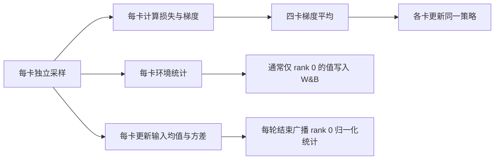

# MimicLite latent tracker：W&B 指标、rank 0 与输入归一化

更新时间：2026-10-13。以下依据本地改造工程的实际实现，不是上游所有版本的通用定义。

## 1. 对应训练与评测

| 运行 | 数据与设置 | 链接 |
|---|---|---|
| 原始小集 | 12 条动作、4096 环境/卡、1144 轮 | [bdwjkk7j](https://wandb.ai/langlang-02-ustc/mimic_lite/runs/bdwjkk7j) |
| 上一轮扩集 | 128 条、4096 环境/卡、1144 轮，从 small12 热启动 | [trdbqxt2](https://wandb.ai/langlang-02-ustc/mimic_lite/runs/trdbqxt2) |
| PPO 诊断 | 128 条、4096 环境/卡、100 轮，从 small12 热启动 | [c8ea7796](https://wandb.ai/langlang-02-ustc/mimic_lite/runs/c8ea7796) |
| 本轮正式训练 | 128 条、8192 环境/卡、2288 轮，从 small12 独立热启动 | [e876ed30](https://wandb.ai/langlang-02-ustc/mimic_lite/runs/e876ed30) |

正式训练使用 GPU 0–3，共 32768 个环境；每轮 rollout 32 步，采集 1,048,576 条环境转移。PPO 每轮 3 个 epoch、每个 epoch 8 个 minibatch，共 24 次参数更新。正式训练于 2026-10-13 07:00 UTC 完成，退出码 0，最终模型 `checkpoint_2288.pt`。

网络：Actor `[512,512,512]`，Critic `[1024,512,256]`。控制频率 50 Hz，单控制步 0.02 秒。

## 2. 为什么多数环境统计只来自 rank 0？

### 2.1 rank 是训练进程编号

在这次单机四卡训练中，每张卡对应一个训练进程：rank 0、1、2、3；因为 CUDA_VISIBLE_DEVICES 为 0,1,2,3，恰好分别对应物理 GPU 0–3。rank 0 只是主进程编号，不是特殊的策略或更高权重的 GPU。

每个进程都维护：

- 8192 个独立仿真环境及采样得到的轨迹；
- 一份 Actor、Critic 和优化器；
- 自己的 episode 统计和输入归一化统计。

四卡共同训练同一个策略：每次反向传播后，代码对四卡梯度做 `all_reduce(AVG)`，各进程使用平均梯度更新参数。初始网络参数也会广播对齐。因此 GPU 1–3 的训练样本确实参与了学习。

### 2.2 写日志不等于同步指标

当前 `train.py` 中，只有 `aa.is_main_process()` 为真时才初始化 W&B 并执行 `run.log(info)`，避免四个进程各自创建重复的 W&B run。

但是，写日志之前没有把所有环境指标统一做跨卡归约：

- `episode_stats` 是本进程收集的已结束 episode；
- reward EMA 是本进程环境中的滑动统计；
- 多数 Actor/Critic 损失也是本进程 minibatch 的统计。

于是 rank 0 写出的这些值只代表 rank 0 的环境/样本，不会因为网络梯度已经同步就自动变成四卡平均。

部分指标例外：用于调整学习率的 `actor/kl` 显式跨卡平均；`env_frames` 乘了 world size；`vecnorm/*_diff_*` 本身来自跨卡 gather。不能把所有图都理解成 rank 0 局部量，也不能把所有图都理解成四卡总体量。

这种做法省去部分通信和统计代码，rank 0 的 8192 个环境通常能提供有用的趋势，但它并非精确的全量统计；动作、失败回退和随机化的分布可能让不同卡的结果不一样。

如果以后改成全局环境统计，应归约“总和 + 数量”，而不是简单平均四卡的均值。例如全局失败率应是 `四卡失败 episode 总数 / 四卡结束 episode 总数`，因为四卡结束的 episode 数可能不同。当前没有修改统计行为。

### 2.3 三种操作分别是什么

## 3. 四张卡的输入归一化是什么意思？

### 3.1 归一化的是网络输入的每一维

输入包含不同量纲和尺度：关节角、关节速度、角速度、历史动作、latent 等。如果直接混在一起，大数值的维度容易影响优化尺度。

VecNorm 持续估计每一维的均值 μ 和标准差 σ，然后把输入转换为约 `(x − μ) / σ`；代码还带数值保护。例：某维关节速度均值为 2、标准差为 4，当前值 6，归一化后约为 1，表示比平均值高一个标准差。

它不是把物理状态或参考动作改掉，也不是强制所有输入都落在 `[0,1]`。

本项目分三组维护统计：

| 组 | 内容 | 使用者 |
|---|---|---|
| `command` | 512 维当前 latent + 1 维 phase | Actor 与 Critic |
| `policy` | 535 维本体状态/动作历史 | Actor 与 Critic |
| `priv` | 550 维特权参考和误差信息等 | Critic |

输入 VecNorm 与隐藏层的 LayerNorm 是两种不同操作；RVQ 编码器训练时的数据标准化又是另一层处理。

### 3.2 为什么四卡统计会不同？

四张卡采到的动作片段、状态、失败回退位置和随机扰动不同。每卡在 rollout 时使用自己最近看到的观测更新统计，均值和尺度会产生差异，即使网络参数相同。

当前流程为：

1. rollout 时各卡本地更新 VecNorm；
2. PPO 更新期间冻结统计，避免同一批数据反复改变归一化；
3. 每轮训练结束，先记录各卡统计的差异；
4. 调用 `synchronize(mode="broadcast")`，将 **rank 0 的 sum、ssq、count** 广播到其他卡。

所以“归一化同步”在当前代码中是采用 rank 0 的统计，不是四卡统计合并后的精确总体均值。rank 1–3 的当前本地统计在同步时被覆盖，但它们已经产生的训练梯度仍参与四卡平均。

该机制能对齐统计，也可能让不同卡在一轮内经历轻微不同的输入缩放；它是否影响效果需要对照实验，不能仅凭存在差异就认定为 bug。评测时会加载 checkpoint 中的统计并冻结。

### 3.3 `vecnorm` 指标

每组 `command`、`policy`、`priv` 都有四项：

| 后缀 | 含义 | 理想表现 |
|---|---|---|
| `loc_diff_max` | 当前卡与各卡均值向量差异的最大值 | 较小、稳定 |
| `loc_diff_mean` | 上述差异的跨卡平均 | 较小、稳定 |
| `scale_diff_max` | 标准差向量差异的最大值 | 较小、稳定 |
| `scale_diff_mean` | 上述尺度差异的跨卡平均 | 较小、稳定 |

每对卡先把各维绝对差求和，再跨卡取 max/mean；不是单维最大误差，也不是逐维平均误差。因此不同维数的输入组不可直接按数值大小排名。记录发生在同步前，非零正常，持续扩大或突然尖峰才值得检查。

## 4. 先辨认 W&B 指标的统计方式

| 前缀 | 含义 | 注意 |
|---|---|---|
| `reward.tracking/...`、`reward.loco/...` | 加权的单步奖励 EMA | 不是整个 episode 累计回报 |
| `reward.tracking_metrics/...`、`reward.loco_metrics/...` | 误差/辅助统计 EMA | metrics 组不参与策略奖励 |
| `train/stats/...` | 已结束 episode 的统计 | 奖励、误差项是 episode 内累计量 |

reward EMA 默认 decay 为 0.99；W&B 页面平滑可能再叠加一层。`train/stats` 不一定每轮都有点。

环境统计在奖励乘 `step_dt` 之前累计，而学习器收到的奖励默认乘 `step_dt`。因此 episode return 和 Critic 的目标回报数值尺度不同。

## 5. 跟踪误差：`reward.tracking_metrics/`

| 项 | 含义 | 单位 / 好的趋势 |
|---|---|---|
| `root_pos` | 参考与机器人 torso_link 的世界坐标位置距离 | 米；下降 |
| `root_ori` | torso_link 的三维朝向角误差，不只是 yaw | rad；下降 |
| `body_pos` | 各跟踪 link 的局部位置误差平均 | 米；下降 |
| `body_ori` | 各跟踪 link 的局部朝向误差平均 | rad；下降 |
| `joint_pos` | 所选关节角度平均绝对误差 | rad；下降 |

例如 0.18 m 是 18 cm，0.15 rad 约 8.6°。局部坐标去掉各自的水平平移和 heading 后，可出现“身体姿态很好但整体漂移”，所以 body_pos 低不能代替 root_pos 低。

这些是平均误差，终止条件可能由一个 link 连续超阈值触发，平均误差低于阈值也可能失败。离线评测的 `root_position_error_m` 使用 pelvis，这里的 root 使用 torso_link，定义略有不同。

## 6. 跟踪奖励：`reward.tracking/`

当前这些项采用类似 `weight × exp(−平均误差 / sigma)` 的形式，不是统一用误差平方。越接近上限越好，但必须保持相同采样分布才容易比较。

| 项 | 跟踪目标 | 当前上限 |
|---|---|---:|
| `root_pos` | 根世界位置 | 0.5 |
| `root_ori` | 根世界朝向 | 0.5 |
| `root_linvel` | 根线速度 | 0.5 |
| `root_angvel` | 根角速度 | 0.5 |
| `body_pos` | 各 link 局部位置 | 1.0 |
| `body_ori` | 各 link 局部朝向 | 1.0 |
| `body_linvel` | 各 link 世界线速度 | 0.5 |
| `body_angvel` | 各 link 世界角速度 | 0.5 |
| `joint_pos` | 关节角度 | 0.5 |
| `joint_vel` | 关节速度 | 0.5 |

理想趋势：上升并稳定。权重和 sigma 不同，不能直接横向比较奖励数值。对持续漂移，应同时看 root_pos、root_linvel 及对应误差。

## 7. 运动约束奖励：`reward.loco/`

| 项 | 含义 | 怎样算好 |
|---|---|---|
| `action_rate_l2` | 相邻动作差值平方和的负惩罚 | 跟踪不变差时靠近 0，减少抖动 |
| `joint_vel_l2` | 关节速度平方和的负惩罚 | 减少无用高速运动；不能为了趋近 0 而不跟动作 |
| `joint_pos_limits` | 超出软关节限位的负惩罚，当前乘 10 | 靠近 0 |
| `self_collisions` | 检测到自碰撞的负惩罚 | 靠近 0 |
| `feet_slip` | 接地时脚水平滑动的负惩罚 | 靠近 0；当前 disabled，仅统计、不参与优化 |
| `feet_air_time` | 落脚时，对高度修正后的腾空时间不足阈值施加惩罚 | 通常靠近 0；不是腾空越长奖励越多 |
| `survival` | 每步固定生存奖励 | 当前基本恒为 4，平直正常 |

`feet_air_time` 在站立环境被屏蔽；通过不落脚或不运动获得更少惩罚并不代表跟踪变好。

辅助组 `reward.loco_metrics/`：

| 项 | 实际含义 | 趋势 |
|---|---|---|
| `joint_pos_limits` | 权重为 1 的软限位负惩罚 | 趋近 0 |
| `feet_contact_count` | 每步新落脚接触比例，双脚平均 | 反映落脚频率，没有统一升降目标；不是当前接触脚数量 |
| `feet_contact_duration` | 当前接触状态比例，双脚平均 | 不是秒数；站立接近 1 正常，行走看步态 |

## 8. Episode 与终止：`train/stats/`

| 项 | 含义 | 理想趋势 / 限制 |
|---|---|---|
| `episode_len` | 已结束 episode 平均控制步数 | 同分布下通常上升；乘 0.02 得秒数 |
| `success` | episode 长度达到 max_episode_length 的 90% | 当前不能当作动作成功率 |
| `termination/motion_timeout` | episode 结束时触发动作结束的比例 | 通常升高较好，但不等于整段动作成功率 |
| `termination/root_pos_error` | 根位置失败标志比例 | 下降 |
| `termination/root_ori_error` | 根朝向失败标志比例 | 下降 |
| `termination/body_pos_error` | 局部 link 位置失败标志比例 | 下降 |
| `termination/body_ori_error` | 局部 link 朝向失败标志比例 | 下降 |

当前失败条件：

- root_pos_error：torso_link 误差超过 0.4 m，连续 25 步（0.5 秒）。
- root_ori_error：torso_link 朝向误差超过 1.2 rad，连续 25 步。
- body_pos_error：某个受监测 link 局部位置超过 0.4 m，连续 5 步（0.1 秒）。
- body_ori_error：某个受监测 link 局部朝向超过 1.2 rad，连续 5 步。

正式训练保留全部这些条件，root_pos_error 的 is_timeout=false。

`success` 要求至少 900 步（18 秒），而动作最长约 9.8 秒，因此常为 0，不能据此判断训练完全失败。训练允许随机起点和失败回退，完成剩余片段也会触发 motion_timeout；多个终止标志可以同时出现，比例不一定合计为 1。

重复的累计字段：

| 字段 | 含义 |
|---|---|
| `tracking/<上述10项>` | 对应加权 tracking 奖励沿 episode 累计 |
| `loco/<上述7项>` | 对应 loco 奖励/惩罚累计，包括 disabled 项的统计 |
| `tracking/return` | 启用的 tracking 奖励累计总和，通常希望上升 |
| `loco/return` | 启用的 loco 奖励累计总和，包括 survival |
| `tracking_metrics/<上述5项>` | 误差沿 episode 累加，不是平均误差 |
| `loco_metrics/<上述3项>` | 对应辅助量沿 episode 累加 |
| `tracking_metrics/return`、`loco_metrics/return` | 当前各项不启用为奖励，总和通常为 0，可忽略 |

累计负惩罚或累计误差变大，可能只是 episode 更长。优先用单步 EMA、完整率和相同时长的离线误差判断。

## 9. Actor 与优化器

| 指标 | 含义 | 怎样算好 |
|---|---|---|
| `actor/policy_loss` | PPO 裁剪策略损失 | 不要求单调下降或接近 0，结合 KL 和评测 |
| `actor/kl` | 新旧动作分布 KL，当前被用于调节学习率 | 有限、受控；不是越小越好 |
| `actor/clamp_ratio` | 动作概率比超出 [0.8,1.2] 的样本比例 | 不宜长期接近 1；接近 0 也可能更新过弱 |
| `actor/lr` | 实际 Actor 学习率 | 无统一升降目标；长期触底需结合 KL 分析 |
| `actor/entropy` | 29 维连续动作分布总熵 | 常见为下降后稳定，不能过早塌缩；不限 [0,1] |
| `actor/entropy_coef` | 熵奖励权重 | 当前固定 0.004，水平线正常 |
| `actor/mean_std` | 更新期间动作分布标准差均值 | 稳定，不应异常暴涨或过早归零 |
| `opt/grad_norm.actor` | Actor 裁剪前梯度范数 | 有限、稳定，持续尖峰需查 |
| `opt/grad_norm.critic` | Critic 裁剪前梯度范数 | 同上 |

clamp_ratio 是概率比裁剪比例，不是梯度裁剪比例。梯度范数上限为 1，但日志记录裁剪前值，所以大于 1 不表示裁剪失效。

KL 目标 0.01。每个 minibatch 后：KL > 0.02 则 lr / 1.5，最低 1e-5；0 < KL < 0.005 则 lr × 1.5，最高 1e-2。图上是整轮均值，不会每个点都等于目标。

## 10. 各关节探索噪声：`actor_std/`

它们是训练时 Gaussian 动作分布的可学习标准差，不是关节实际运动的标准差，也不是误差；动作经过缩放后才对应关节目标变化。

| 名称模式 | 对应关节数量 |
|---|---:|
| `left/right_hip_pitch/roll/yaw_joint` | 髋 6 |
| `left/right_knee_joint` | 膝 2 |
| `left/right_ankle_pitch/roll_joint` | 踝 4 |
| `waist_pitch/roll/yaw_joint` | 腰 3 |
| `left/right_shoulder_pitch/roll/yaw_joint` | 肩 6 |
| `left/right_elbow_joint` | 肘 2 |
| `left/right_wrist_pitch/roll/yaw_joint` | 腕 6 |
| `mean` | 上述 29 项平均 |

理想表现是探索强度逐渐稳定，同时跟踪改善；不要求所有关节相同或全部趋于 0。`actor/mean_std` 为更新中 minibatch 的均值，`actor_std/mean` 为更新结束后的参数均值，可能略有差别。

## 11. Critic：两个奖励组各有一套

前缀为 `critic/tracking.` 或 `critic/loco.`。

| 后缀 | 含义 | 怎样算好 |
|---|---|---|
| `explained_var` | 当前实现为 1 − 价值预测 MSE / 目标回报方差 | 趋近 1；负值值得检查 |
| `value_loss` | 价值预测与目标回报 MSE | 回报尺度相近时下降并稳定 |
| `ret_mean` | Critic 训练目标回报均值 | 通常提高较好，但受奖励、终止、bootstrap 等影响 |
| `ret_std` | 目标回报标准差 | 没有统一升降目标；不是模型不确定性 |
| `neg_rew_ratio` | 当前样本中该组即时奖励 ≤ 0 的比例 | 与奖励定义有关，不是“负回报 episode 比例” |

解释方差 0.98 不代表 98% 动作成功率；Critic 也可能准确预测糟糕行为的回报。

## 12. PPO 诊断运行专有字段

正式训练关闭 ppo_diagnostics；这些字段只在 c8ea7796 中有。

| 指标 | 含义 / 用途 |
|---|---|
| `diagnostics/kl_all` | 当前 minibatch 梯度更新前的全部样本 KL |
| `diagnostics/kl_valid` | 排除 is_init 样本后的 KL |
| `diagnostics/kl_init` | 仅 is_init 样本的 KL |
| `diagnostics/valid_count` | 有效样本数 |
| `diagnostics/init_count` | 初始化样本数 |
| `diagnostics/init_fraction` | 初始化样本比例 |
| `diagnostics/first_update_kl_all` | 每轮第一次梯度更新前的全部样本 KL |
| `diagnostics/first_update_kl_valid` | 同时刻有效样本 KL |
| `diagnostics/first_update_kl_init` | 同时刻初始化样本 KL |
| `diagnostics/first_update_valid_count` | 第一个 minibatch 有效样本数 |
| `diagnostics/first_update_init_count` | 第一个 minibatch 初始化样本数 |
| `diagnostics/first_update_init_fraction` | 第一个 minibatch 初始化样本比例 |

普通 diagnostics 字段是 rank 0 各 minibatch 的平均，count 也是数量的平均；first_update 只来自第一个 minibatch。空的初始化子组 KL 记为 0，应结合 init_count 看。

第一次更新前 KL 理想为 0；后续 minibatch 因已经更新策略，非零正常。初始化比例没有固定理想值，频繁提前失败可能使其上升。

100 轮诊断结果：all KL≈0.02354，valid KL≈0.02357，init KL≈0.01566，init 比例≈0.59%；首次更新前 KL 为 0。初始化样本不是高 KL 的主要来源；也未在该检查点发现采样/更新分布不一致。学习率仍在 1e-5 下限。这不是网络容量或训练不足的直接证明。

## 13. 性能、系统与辅助字段

| 指标 | 含义 / 趋势 |
|---|---|
| `env_frames` | 四卡累计采样步数，单调增加；当前每轮 +1,048,576 |
| `performance/rollout_fps` | 四卡估算总采样吞吐；同配置越高越快，不表示策略更好 |
| `performance/rollout_time` | 每轮采样耗时；同配置越低越快 |
| `performance/training_time` | 每轮 PPO 更新耗时 |
| `performance/iter_time` | 每轮总耗时，用于估算 ETA |
| `_step` | W&B 日志步数，通常从 0 开始，当前近似对应训练轮次 |
| `_runtime`、`_wandb.runtime` | W&B 运行时间 |
| `_timestamp` | 日志时间戳 |
| `system.cpu` | CPU 使用率 |
| `system.memory_percent` | 系统内存使用比例 |
| `system.proc.memory.rssMB` | 进程驻留内存 |
| `system.proc.memory.percent` | 进程内存比例 |
| `system.proc.memory.availableMB` | 可用内存 |
| `system.proc.cpu.threads` | 进程线程数 |
| `system.disk./.usageGB`、`usagePercent` | 文件系统使用量和比例 |
| `system.disk.<设备>.in/out` | 各磁盘的读写统计，单位按 W&B 图例 |
| `system.network.recv/sent` | 网络接收/发送统计 |

系统指标用于发现资源瓶颈，不直接反映策略质量。持续内存上涨、磁盘将满或吞吐异常下降值得检查。本次读取的 W&B system events 中没有 GPU 指标；缺少曲线不等于没有用 GPU。

本地 metrics.jsonl 另外包含 `iteration`、`wall_time`、`nonfinite_metrics`、`non_scalar_metrics`、`metric_scope`，它们是本地记录元数据，不是全都上传到 W&B 的训练曲线。nonfinite_metrics 应为空；非有限值应排查。

## 14. 判断趋势的顺序

1. 固定动作、固定终止规则下的完整成功率与完成比例。
2. 单步 root_pos、body_pos、joint_pos 等误差，及同长度片段误差对比。
3. 各类失败比例与 motion_timeout、episode_len 联合分析。
4. reward 是否与这些改善一致。
5. KL、lr、std、value_loss、梯度范数用于解释优化过程。
6. 性能指标用于评估成本。

训练包含随机起点、失败回退、随机化和随机动作；离线评测使用确定性动作并从开头跟踪。更高训练 reward 不自动等于更高完整动作成功率。提前失败也会缩短误差统计区间，跨模型不要只比整段平均误差。

不同 run 若同时改变数据集、环境数、训练轮数或终止定义，不能只看曲线高低下结论。当前 8192/2288 对比 4096/1144 同时改变了环境数和轮数，总采样量约 4 倍，不能单独分离这两个因素的贡献。

## 15. 实现位置

以下相对于仓库根目录：

- `mimic-lite/scripts/train.py`：rank 0 的 W&B 写入、episode 日志、env_frames。
- `mimic-lite/mimic_lite_learning/ppo.py`：PPO loss、KL、学习率、梯度平均、VecNorm 同步、诊断指标。
- `mimic-lite/mimic_lite_learning/common.py`：归一化跨卡差异、Actor 标准差。
- `active-adaptation/active_adaptation/learning/modules/vecnorm.py`：输入统计更新与 broadcast/aggregate 实现。
- `active-adaptation/active_adaptation/envs/env_base.py`：累计奖励、success、终止统计。
- `active-adaptation/active_adaptation/envs/mdp/rewards/base.py`：reward 加权与 EMA。
- `mimic-lite/mimic_lite/tasks/rewards/track.py`：跟踪奖励与误差。
- `mimic-lite/mimic_lite/tasks/rewards/feet.py`：脚部统计的实际定义。
- `mimic-lite/cfg/task/tracking-base.yaml`：奖励权重与默认任务设置。
- `active-adaptation/projects/hdmi/scripts/experiments/20261012T152258Z-diag-8192-pipeline/train-resolved.yaml`：本轮最终解析配置。

## 16. 本轮评测产物

模型：e876ed30 的 checkpoint_2288.pt。评测选择与上一轮完全相同的 128 条训练动作和 20 条固定验证动作，seed42，保留全部终止条件。

- 后台 session：`mimiclite-eval8192-20261013`。
- 输出目录：`/mnt_scalelab/langlang/home/runs/mimiclite/eval-20261013T115903Z-train128-8192`。
- `index.html`：运行中显示已完成动作；结束后自动替换为完整对比报告。
- `comparison.json`：与 trdbqxt2 的分组、分类和逐动作对比，评测结束后生成。
- `summary.csv`：逐动作成功与完成比例变化，评测结束后生成。
- `matched-prefix-errors.json`：共享时长片段的误差对比，评测结束后生成。
- `video-verification.json`：全部视频的解码校验，评测结束后生成。
- `exit-code.txt`：评测和报告流程结束后写入，0 表示完整流程成功。

旧模型对比基准：训练集 82/128，固定验证集 3/20；原始12条为10/12，新增116条为72/116。本轮结果以实际完成的报告为准。
